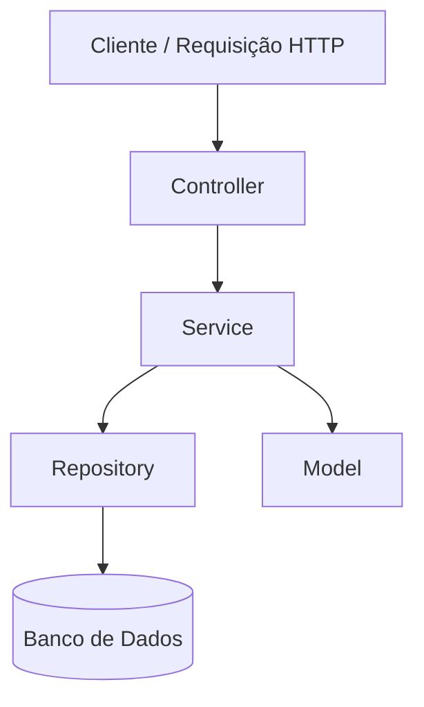

# 💳 Payment System
### Backend de Pagamentos Escalável | Arquitetura em Camadas com Java + Spring Boot

**Um backend escalável que simula uma plataforma de pagamentos real (similar a Stripe ou PicPay), com foco em consistência transacional, gerenciamento de saldo e arquitetura limpa.**

[Visão Geral](#-visão-geral) •
[Funcionalidades](#%EF%B8%8F-funcionalidades) •
[Arquitetura](#-arquitetura) •
[Stack](#-stack-tecnológica) •
[Foco de Engenharia](#-foco-de-engenharia) •
[Próximos Passos](#-melhorias-futuras)

---

## 🌐 Demonstração

🔗 **[benjaminreiis.github.io/payment-system](https://benjaminreiis.github.io/payment-system/)**

---

## 🧠 Visão Geral

Este projeto representa um serviço de backend responsável por lidar com operações financeiras entre usuários, garantindo **consistência** e **confiabilidade** dos dados.

Foi desenhado para demonstrar habilidades de engenharia de backend utilizando **Java** e práticas arquiteturais modernas — sem necessariamente cobrir todos os detalhes de um ambiente de produção real (veja as [notas](#-notas) abaixo).

---

## ⚙️ Funcionalidades

- 👤 Estrutura de conta de usuário
- 💰 Gerenciamento de saldo de conta
- 🔄 Transferência de dinheiro entre contas
- 📋 Rastreamento de transações
- ⚠️ Tratamento básico de erros

---

## 🏗 Arquitetura

O projeto segue uma **arquitetura em camadas** (*layered architecture*):

| Camada | Responsabilidade |
|---|---|
| **Controller** | Recebe e trata as requisições HTTP |
| **Service** | Contém a lógica de negócio |
| **Repository** | Camada de acesso a dados |
| **Model** | Entidades de domínio |

Essa estrutura melhora a **manutenibilidade**, **escalabilidade** e a **separação de responsabilidades** do sistema.

---

## 🛠 Stack Tecnológica

| Categoria | Tecnologia |
|---|---|
| **Linguagem** | Java |
| **Framework** | Spring Boot |
| **Banco de Dados** | PostgreSQL *(conceitual)* |
| **Arquitetura** | Em camadas (Controller, Service, Repository) |

---

## 📈 Foco de Engenharia

Este projeto prioriza conceitos de design e arquitetura backend, mais do que a entrega de um sistema pronto para produção:

- 🏛️ Design de sistemas backend
- ⚛️ Consistência transacional
- 🧹 Código limpo e bem estruturado
- 📐 Fundamentos de escalabilidade

---

## 🚀 Melhorias Futuras

- [ ] Autenticação JWT
- [ ] Idempotência para transações
- [ ] Processamento assíncrono (Kafka/RabbitMQ)
- [ ] Cache com Redis
- [ ] Logging e monitoramento

---

## 📌 Notas

> Este projeto tem como foco demonstrar **conceitos de arquitetura backend e design de sistemas**, e não um deploy completo em produção. O PostgreSQL é referenciado como banco de dados **conceitual**, representando a camada de persistência pretendida pela arquitetura, mesmo que a integração completa ainda não esteja implementada.

---

## 🤝 Como Contribuir

1. Faça um fork do projeto
2. Crie uma branch (`git checkout -b feature/minha-feature`)
3. Commit suas alterações (`git commit -m 'feat: adiciona minha feature'`)
4. Push para a branch (`git push origin feature/minha-feature`)
5. Abra um Pull Request

---

## 👨‍💻 Autor

**Benjamin Reis**

---

## 📄 Licença

Este projeto está sob a licença MIT. Veja o arquivo [LICENSE](LICENSE) para mais detalhes.

---

⭐ Se este projeto foi útil, considere deixar uma estrela no repositório!

